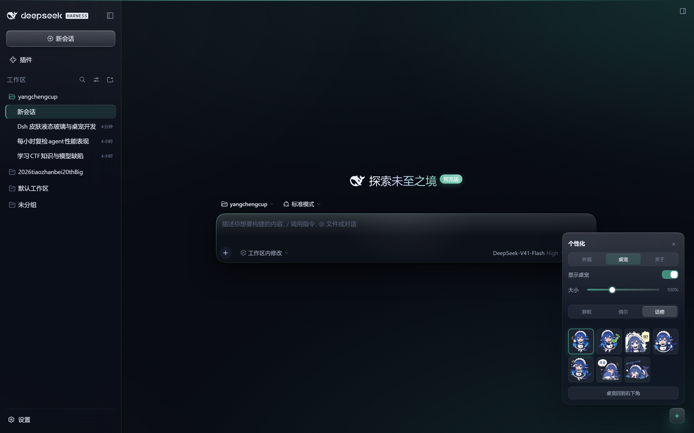

# Aurora — 液态玻璃皮肤 + 鲸鱼娘桌宠 + 个性化面板（可一键撤销）

<div align="center">

**青玉色玻璃面板、缓慢流动的光场与一层极细噪点；右下角一只会换表情的 DeepSeek 鲸鱼娘；外观全部在应用内的「个性化」面板里调。**




</div>

---

## 功能

| | |
|---|---|
| **三套底色风格** | **墨银**（暖灰黑 + 香槟金，默认）/ **深海**（藏蓝 + 青）/ **暖砂**（褐黑 + 琥珀）；面板「外观 → 风格」里秒切，强调色还能再单独覆盖 |
| **投放式皮肤包** | 把 `~/.dsh/aurora-packs/<id>/`（`pack.json` + `theme.css`）丢进去，面板「外观 → 皮肤包」立刻出现，点一下生效，刷新即热更；坏包只影响自己，详见 [docs/skin-packs.md](docs/skin-packs.md) |
| **液态玻璃** | 侧栏/输入框/对话框/右栏半透明 + `backdrop-filter` 磨砂；背景是缓慢漂移的光场 + 4% 噪点，鼠标移动时输入卡上有一道跟随指针的镜面高光 |
| **个性化面板** | 右下角 `✦` 打开，三个标签页：**外观**（5 套预设 + 任意自定义颜色、磨砂 0–60px、通透、圆角、动效）、**桌宠**（显示开关、大小、话痨程度、表情试玩、归位）、**关于**（版本/署名/恢复默认） |
| **鲸鱼娘桌宠** | 7 种表情（招呼/完成/待命/惊讶/鼓气/摸鱼/犯困）；可拖拽、悬停变开心、点击随机反应并说一句话、90 秒无操作自己犯困 |
| **跟随 DSH** | 深/浅色跟随系统或设置；键盘焦点、`prefers-reduced-motion`、无 `backdrop-filter` 引擎都有降级 |
| **一键撤销** | 删一个 patch 条目 + 两个 junction，刷新即回原版；不碰 `app.asar` |

## 一键应用 / 撤销

> 本机 PowerShell 是 `Restricted` 策略，用 `.cmd` 包装器（内部 `-ExecutionPolicy Bypass`）。

```bat
D:\yangchengcup\ui\apply.cmd            :: 装（默认 desktop profile）
D:\yangchengcup\ui\revert.cmd           :: 撤
D:\yangchengcup\ui\restart-dsh.cmd      :: 重启 DSH
```

`apply.ps1` 会：

1. 把两个包声明成 `link:` 依赖并 mount 成 junction 到本仓库
   （`<DSH_HOME>\profiles\<name>\node_modules\dsh-theme-aurora{,-browser}`）；
2. 在 `cordis.patch.yml` 末尾追加带标记的 `insert` 块；
3. 首次修改前把原 patch 备份为 `cordis.patch.yml.aurora-backup`。

**什么时候要重启**：改了 `lib/index.js`（宿主侧）或 `src/overlay.js`（生成 client.js）后需要重启；**只改 `aurora.css` 不用**——浏览器端会从 `/aurora/theme.css` 拉最新样式表，刷新即可。

## 架构

```
ui/
├─ aurora/                       主包：宿主注入 + 浏览器端样式
│  ├─ lib/index.js               index-inject + /aurora/theme.css
│  ├─ lib/aurora.css             全部视觉（液态玻璃 / 面板 / 桌宠）
│  ├─ lib/client.js              生成物：baked CSS + 拉取最新 CSS
│  ├─ src/overlay.js             个性化面板 + 鲸鱼娘（React，slot: shell.overlay）
│  └─ tools/build.mjs            把 CSS + overlay 打包成 client.js
├─ aurora-browser/               浏览器面：唯一挂 overlay / 提供 /aurora/ping 与表情图
│  ├─ assets/pet/*.png           7 张表情立绘（CC BY-NC-SA，见 assets/pet/CREDITS.md）
│  └─ lib/index.js               /aurora/ping、/aurora/pet/<name>.png（白名单）
├─ assets/pet/CREDITS.md         素材署名与许可
└─ screenshots/                  版本截图
```

主包负责 `webserver/index-inject` 与样式表；浏览器面包负责浏览器端条目、桌宠 slot 与表情资源。宿主的客户端插件元数据按 specifier 缓存，所以运行时**新增**一个 specifier 才能被识别。

## 自定义

**界面上**：`✦` → 外观/桌宠/关于，所有选择立刻生效并写入 `localStorage`。

**配置文件里**（`cordis.patch.yml` 的插件条目）：

```yaml
- id: theme-aurora
  name: dsh-theme-aurora
  config:
    accent: "#4fb59a"   # 强调色
    accent2: "#8ee0c8"  # 辅助色
    blur: 26            # 0–60
    glass: 1            # 0.2–1
    motion: full        # full | subtle | none
    radius: 24          # 12–32
    petScale: 1         # 0.8–1.4
    chatty: 2           # 0 | 1 | 2
    petVisible: true
```

优先级：**面板（inline）> 配置（`:root`）> 样式表默认**。配置值经过白名单校验（仅 6 位 hex、数值 clamp、枚举），不会作为 CSS 原文拼接。

**改代码**：编辑 `aurora/lib/aurora.css` → 刷新；改 `src/overlay.js` → `node aurora/tools/build.mjs` 再重启。

## 安全与自查

已按两份独立审查修过：

- `</style` 大小写绕过 → `/<\/style/gi`；
- CSS 读取失败不再让整个 index 404/400：listener 内 try/catch + 上次成功副本兜底；
- `/aurora/ping`：仅 GET/HEAD、仅 loopback、3s 限速、token 只留 `[a-zA-Z0-9-]`、日志 256KB 轮转；
- `/aurora/theme.css`：先读后写头、405、`content-length`、`nosniff`、`no-store`；
- `/aurora/pet/<name>.png`：名字对白名单取模，路径不可穿越；
- 浏览器端 fetch：仅 `text/css`、≤2MiB、3s 超时；样式一律 `textContent`；
- 配置 own-property + null 安全，异常值回落默认；
- 两个包不抢同一 slot / route；
- 撤销脚本只删自己的 `insert` 块，不会误删应用写进标记区间的条目（已用真实 patch 回归）。

**已知取舍**：

- 侧栏在 Windows 标题栏模式下关闭 `backdrop-filter`（否则 `position:fixed` 的标题栏按钮会被重新锚定并裁掉）；
- 输入卡不做 `backdrop-filter`、聚焦不做 `transform`（避免把卡内 `/`、`@` 弹层困进层叠上下文）；
- 折叠的右栏面板不绘制（它有 720px 宽、悬在中栏上，任何背景/模糊都会遮挡对话）；
- 宠物图为社区二创（CC BY-NC-SA 4.0），**不在 MIT 范围内**。

## 宠物形象来源

表情图来自 [xxnb0/deepseek-chan-fanpack](https://github.com/xxnb0/deepseek-chan-fanpack)，形象溯源 **上善无形** 与 **ZipZipPipe**，**CC BY-NC-SA 4.0**（署名、非商业、相同方式共享）。本仓库做了去底、裁切与 320px 缩放。详见 [`assets/pet/CREDITS.md`](assets/pet/CREDITS.md)。

## 仓库

- <https://github.com/ShokouP/dsh-aurora>（**private**）
- 代码 MIT；宠物图 CC BY-NC-SA 4.0。

```powershell
$env:HTTP_PROXY='http://127.0.0.1:7890'; $env:HTTPS_PROXY='http://127.0.0.1:7890'
cd D:\yangchengcup\ui; git add -A; git commit -m "tune: ..."; git push
```
