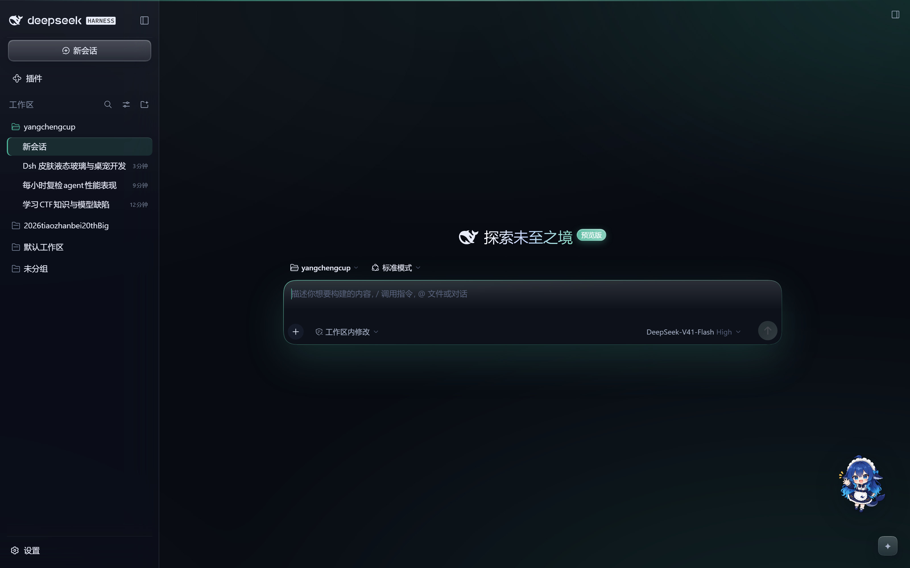
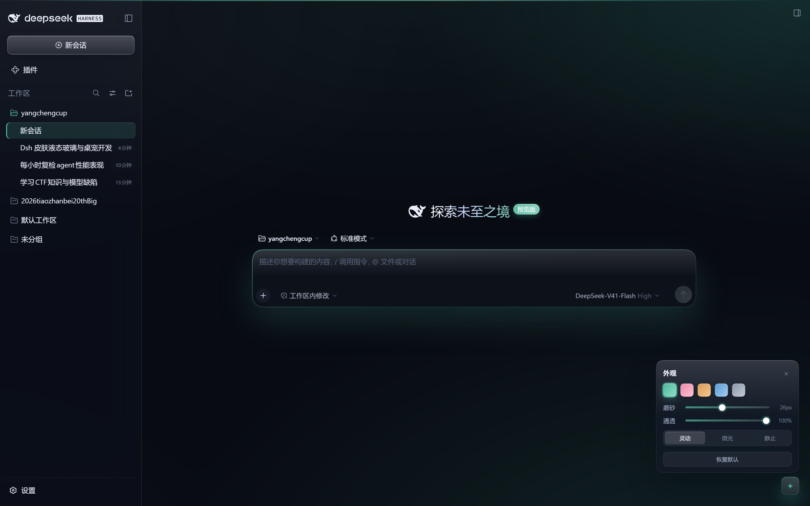

# Aurora — 液态玻璃皮肤 + 鲸鱼娘桌宠（可一键撤销）

<div align="center">

**给 DeepSeek Harness GUI 换一身「液态玻璃」：青玉色玻璃面板、缓慢流动的背景光、可调的磨砂强度，外加一只住在右下角的 DeepSeek 鲸鱼娘。**




</div>

---

## 功能

| | |
|---|---|
| **液态玻璃** | 侧栏/输入框/对话框/右栏使用半透明面板 + `backdrop-filter` 磨砂，背景是一层缓慢漂移的青玉色光场 |
| **可调外观** | 右下角 `✦` 打开面板：5 套强调色（青玉/樱粉/琥珀/天青/石墨）、磨砂 0–60px、通透 20–100%、动效 灵动/微光/静止；选择存在 `localStorage` |
| **鲸鱼娘桌宠** | 可拖拽、会上下浮动、点一下说一句话（"在的～""写完这段就休息一下吧"…），打开外观面板时自动让位 |
| **跟随 DSH** | 深/浅色跟随系统或设置；键盘焦点、`prefers-reduced-motion`、无 `backdrop-filter` 引擎都有降级 |
| **一键撤销** | 删一个 patch 条目 + 两个 junction，刷新即回原版；不碰 `app.asar` |

## 一键应用 / 撤销

> 本机 PowerShell 是 `Restricted` 策略，用 `.cmd` 包装器（内部 `-ExecutionPolicy Bypass`）。

```bat
D:\yangchengcup\ui\apply.cmd            :: 装（默认 desktop profile）
D:\yangchengcup\ui\revert.cmd           :: 撤
D:\yangchengcup\ui\restart-dsh.cmd      :: 重启 DSH（首次装载需要）
```

`apply.ps1` 会：

1. 把两个包复制成 `link:` 依赖并 mount 成 junction 到本仓库
   （`<DSH_HOME>\profiles\<name>\node_modules\dsh-theme-aurora{,-browser}`）；
2. 在 `cordis.patch.yml` 末尾追加带标记的 `insert` 块；
3. 首次修改前把原 patch 备份为 `cordis.patch.yml.aurora-backup`。

**为什么需要重启一次**：桌面端渲染进程的 `index.html` 来自 `app.asar` 里的静态文件，不会经过宿主注入；皮肤靠浏览器端插件（`lib/client.js`）在渲染进程里挂载，而宿主的客户端插件元数据在启动时按 specifier 缓存。装好后重启一次 DSH，之后**改 CSS 只需刷新**——浏览器端会从 `/aurora/theme.css` 拉最新样式表。

## 架构

```
ui/
├─ aurora/                       主包：宿主注入 + 浏览器端样式
│  ├─ lib/index.js               index-inject + /aurora/theme.css
│  ├─ lib/aurora.css             全部视觉（液态玻璃 / 桌宠 / 面板）
│  ├─ lib/client.js              生成物：baked CSS + 拉取最新 CSS
│  ├─ src/overlay.js             外观面板 + 鲸鱼娘（React，slot: shell.overlay）
│  └─ tools/build.mjs            把 CSS + overlay 打包成 client.js
├─ aurora-browser/               浏览器面：唯一挂 overlay / 提供 /aurora/ping 与宠物图
│  ├─ assets/pet.png             鲸鱼娘立绘（CC BY-NC-SA，见下）
│  └─ lib/index.js               /aurora/ping、/aurora/pet.png
├─ assets/pet/CREDITS.md         宠物图署名与许可
└─ screenshots/                  前后对比
```

两个包的分工是有原因的：主包负责 `webserver/index-inject` 与样式表；浏览器面包负责浏览器端条目、桌宠 slot 和宠物资源。宿主的客户端插件元数据按 specifier 缓存，所以**新增**一个 specifier 才能在宿主运行时被识别——这也是当初不重启也能生效的原因。

## 自定义

**界面上**：右下角 `✦` → 面板调色/磨砂/通透/动效，自动保存。

**配置文件里**（`cordis.patch.yml` 的插件条目）：

```yaml
- id: theme-aurora
  name: dsh-theme-aurora
  config:
    accent: "#4fb59a"   # 强调色
    accent2: "#8ee0c8"  # 辅助色
    blur: 26            # 0–60
    glass: 1            # 0.2–1
    motion: full        # full | subtle | none
```

优先级：**面板（inline）> 配置（`:root`）> 样式表默认值**。配置值经过白名单校验（仅 6 位 hex、数值 clamp、枚举），不会作为 CSS 原文拼接。

**改代码**：编辑 `aurora/lib/aurora.css` → 刷新即生效（浏览器端拉取最新）；改了 `src/overlay.js` 则需要 `node aurora/tools/build.mjs` 重新生成 `client.js`。

## 安全与自查

已按两项审查修过（详见提交记录）：

- `</style` 大小写绕过 → `/<\/style/gi`；
- CSS 读取失败不再让整个 index 404/400：listener 内 try/catch + 上次成功副本兜底；
- `/aurora/ping`：仅 GET/HEAD、仅 loopback、3s 限速、token 只留 `[a-zA-Z0-9-]`、日志 256KB 轮转；
- `/aurora/theme.css`：先读后写头、405、`content-length`、`nosniff`、`no-store`；
- 浏览器端 fetch：仅 `text/css`、≤2MiB、3s 超时；样式一律走 `textContent`（不解析 HTML）；
- 配置读取 own-property + null 安全，异常值回落默认，不进入 CSS 文本；
- 两个包不抢同一个 slot / route：只有 `aurora-browser` 挂 overlay 和宠物资源。

**已知取舍**：

- 侧栏在 Windows 标题栏模式下关掉 `backdrop-filter`（否则会把 `position:fixed` 的标题栏按钮重新锚定并被裁掉）；
- 输入框卡片不做 `backdrop-filter`、聚焦不做 `transform`（避免把卡内 `/`、`@` 弹层困进层叠上下文）；
- 折叠的右栏面板不绘制（它有 720px 宽、悬在中栏上，任何背景/模糊都会遮挡对话）；
- 宠物图是社区二创（CC BY-NC-SA 4.0），**不在 MIT 范围内**；商用请自行取得授权。

## 宠物形象来源

`assets/pet.png` 来自 [xxnb0/deepseek-chan-fanpack](https://github.com/xxnb0/deepseek-chan-fanpack) 的「新Q_01_挥手问好」，形象溯源 **上善无形** 与 **ZipZipPipe**，原作者标注 **CC BY-NC-SA 4.0**。本仓库做了去底、裁切与 320px 缩放，仍需署名、非商业、相同方式共享。详见 [`assets/pet/CREDITS.md`](assets/pet/CREDITS.md)。

## 仓库

- 远端：<https://github.com/ShokouP/dsh-aurora>（**private**）
- 代码 MIT；宠物图 CC BY-NC-SA 4.0。

```powershell
$env:HTTP_PROXY='http://127.0.0.1:7890'; $env:HTTPS_PROXY='http://127.0.0.1:7890'
cd D:\yangchengcup\ui; git add -A; git commit -m "tune: ..."; git push
```
