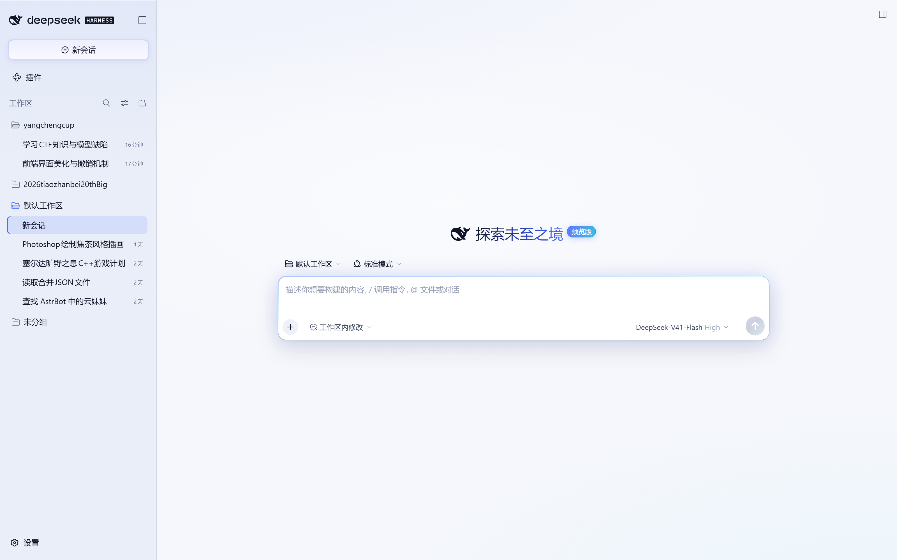
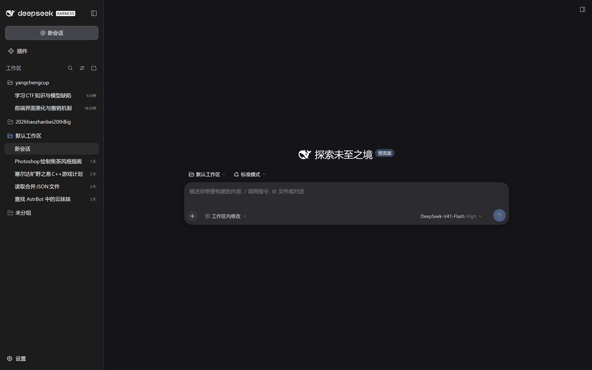

# Aurora — DSH 前端皮肤（可一键撤销）

<div align="center">

**给 DeepSeek Harness 的 Web GUI 换一层"极光"皮肤：深色调、冷光、玻璃质感；一键装，一键撤。**




</div>

---

## 这是什么

Aurora 是一个**纯宿主侧插件**（host plugin），不打包任何浏览器 JS，只做两件事：

1. 通过 `webserver/index-inject` 往每个 `index.html` 里注入一段 `<style>`；
2. 用 `--dsw-*` 设计 token 覆盖 + 少量语义选择器，重绘配色、层次、圆角、光影和动效。

因为改的是"注入"而不是"安装目录里的文件"，所以：

- 不碰 `app.asar`，不破坏签名，升级 DSH 不会冲突；
- 卸载 = 删掉一个 patch 条目，界面立刻回到原样；
- 深浅色都适配，跟随系统切换实时生效。

## 效果对比

| 原版（深色） | Aurora（深色） |
|---|---|
|  |  |

具体变化：

- **环境光**：整屏铺一层极光径向渐变（靛蓝 + 青色），主区不再是死黑一块；
- **层次**：侧栏、画布、输入卡、菜单使用独立的表面阶梯 + 0.5px 发丝边；
- **输入卡**：顶部一道极光高光边，聚焦时外发光；
- **强调色**：发送键是全局唯一的高饱和渐变按钮，选中会话带左侧强调条；
- **标题**：Hero 标题从白渐变到靛蓝，"预览版"徽章改为渐变底；
- **细节**：圆角、滚动条、选区、菜单投影、代码块统一重做。

## 一键应用 / 撤销

> 本机 PowerShell 执行策略是 `Restricted`，所以用 `.cmd` 包装器（内部带 `-ExecutionPolicy Bypass`）。

```bat
:: 应用到桌面端（默认 profile: desktop）
D:\yangchengcup\ui\apply.cmd

:: 撤销
D:\yangchengcup\ui\revert.cmd
```

也可以指定其它 profile：

```bat
apply.cmd web        :: 给 `dsh web` 那个 profile 装
revert.cmd web
```

装完**刷新页面**（`Ctrl+R` / `F5`）生效；撤销同样刷新即可。

`apply.ps1` 做的事：

1. 把 `aurora/` 复制到 `<DSH_HOME>\profiles\<name>\node_modules\dsh-theme-aurora`；
2. 在 `cordis.patch.yml` 末尾追加一个带标记的 `insert` 块：
   ```yaml
   # >>> aurora-skin (managed by ui/apply.ps1 - remove with ui/revert.ps1)
   - insert:
       - id: theme-aurora
         name: dsh-theme-aurora
   # <<< aurora-skin
   ```
3. 第一次修改前，把原 `cordis.patch.yml` 备份成 `cordis.patch.yml.aurora-backup`。

`revert.ps1` 反向删除这两样东西；加 `-RestoreBackup` 还能把 patch 文件整个还原。**整个过程不重启进程**——DSH 的 HMR 会监听 patch 变化并热加载/热卸载。

## 为什么能"随时撤销"

三重保险：

1. **运行时**：`revert.cmd` 删 patch 条目 → 插件热卸载 → 刷新即原版（不用重装 DSH）；
2. **文件级**：`cordis.patch.yml.aurora-backup` 是改动前的原件；
3. **版本级**：本目录是独立 git 仓库，`git checkout .` / `git revert` 可回到任意一次提交。

## 目录结构

```
ui/
├─ apply.ps1 / apply.cmd      装
├─ revert.ps1 / revert.cmd    撤
├─ overlay.yml                实验用 --patch 覆盖层（等价于 apply 的 patch 块）
├─ aurora/                    插件包（会被复制进 profile）
│  ├─ package.json
│  └─ lib/
│     ├─ index.js             宿主侧：注入 style 行 + 写 activity.log
│     └─ aurora.css           全部视觉改动（唯一需要改的文件）
└─ screenshots/               前后对比
```

## 改样式

1. 编辑 `aurora/lib/aurora.css`；
2. 重新执行 `apply.cmd`（把新文件同步进 profile）；
3. 刷新页面。

CSS 分三层，改哪层心里有数：

| 层 | 内容 | 说明 |
|---|---|---|
| Layer 1 | `--dsw-*` token（light / dark 两套） | 改一处，全站生效；主题包定义的语义变量全部可覆盖 |
| Layer 2 | 材质：body 环境光、侧栏、输入卡 | 用 `[data-slot]`、`[data-composer-card]` 等语义钩子 |
| Layer 3 | 细节：滚动条、选区、动效降级 | 尊重 `prefers-reduced-motion` |

选择器统一写成 `html body ...`：客户端 bundle 会在 `<head>` 后面追加自己的样式表，同优先级下后写的赢，这里靠**特指度**压过它，而不是靠顺序。

## 已验证 / 已知限制

**已验证**（本机，2026-10-20）：

- 热加载：修改 `cordis.patch.yml` 后，运行中的 desktop 宿主进程（pid 46464）没有重启就加载了插件，`lib/activity.log` 记录 `apply pid=46464`；
- 热卸载：`revert.ps1` 后界面回到原版（见 `screenshots/before-dark.png`）；
- 视觉：用独立 `aurora-lab` profile 起了一个 `dsh web` 实例，CDP 驱动无头 Edge 截图逐版校对（深浅两套）；
- token 兼容性：从桌面端 `app.asar` 抽出的 `design_platform.css` 与 npm 版**同为 19081 字节**，190 个 token 完全一致；用到的组件钩子（`data-composer-card`、`data-conversation-content`、`role=treeitem[aria-selected]`、`previewBadge`）在桌面端 bundle 中均存在。

**限制**：

- 纯 CSS，没有副作用逻辑；客户端组件卸载时不会"记住"主题，刷新即重新注入；
- 若 DSH 后续重命名 token 或语义钩子，个别细节会失效（配色不会全崩，因为 token 是官方稳定契约）；
- 深色/浅色取自系统或设置里的偏好，皮肤本身不新增主题选项。

## 卸载干净

```bat
revert.cmd
:: 想连备份一起删：
del "%USERPROFILE%\.dsh\profiles\desktop\cordis.patch.yml.aurora-backup"
```

## 发布到 GitHub（走 FlClash 代理）

```powershell
$env:HTTP_PROXY='http://127.0.0.1:7890'; $env:HTTPS_PROXY='http://127.0.0.1:7890'
cd D:\yangchengcup\ui
git remote add origin https://github.com/<you>/dsh-aurora.git
git push -u origin main
```

---

MIT License. 皮肤只改表现层，不改变 DSH 的任何行为。
