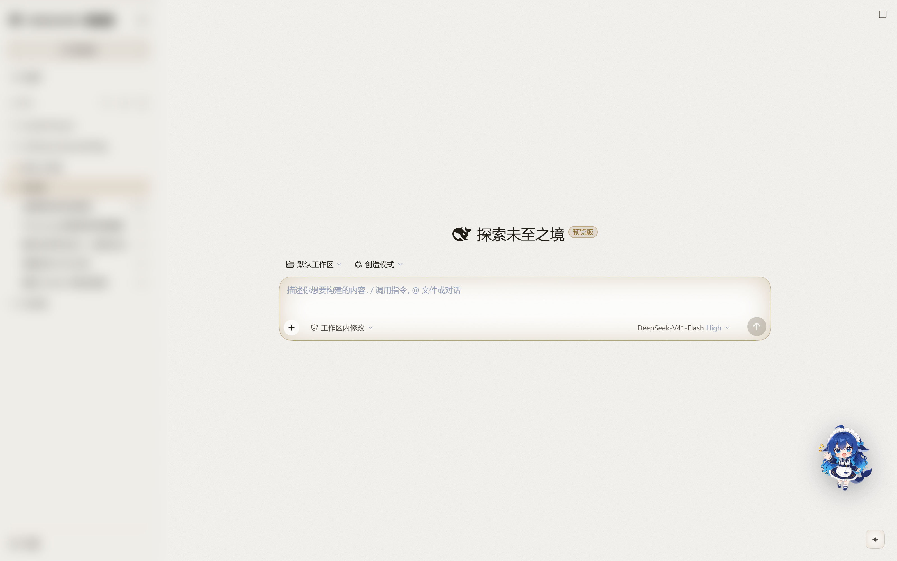
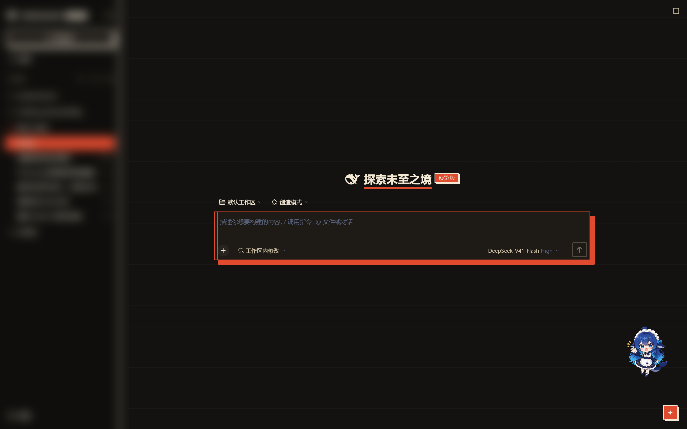
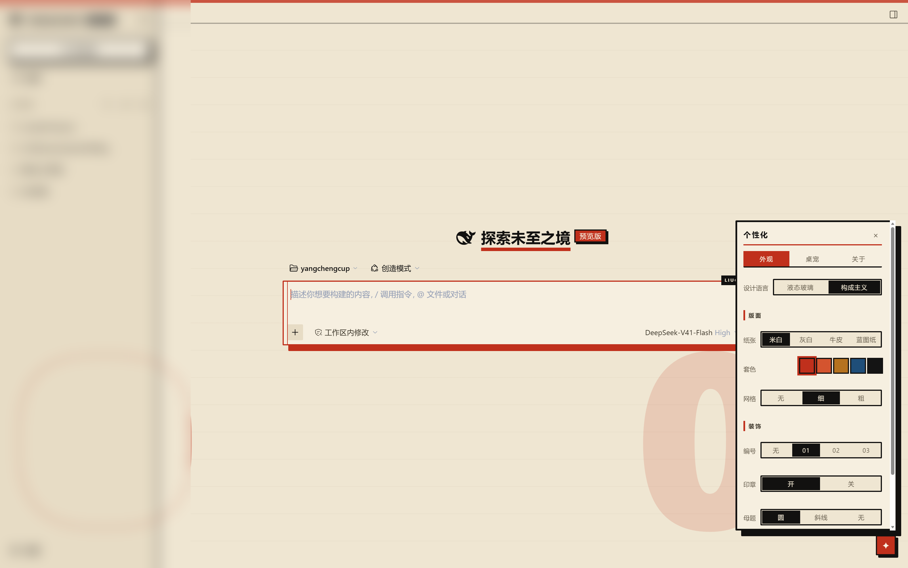
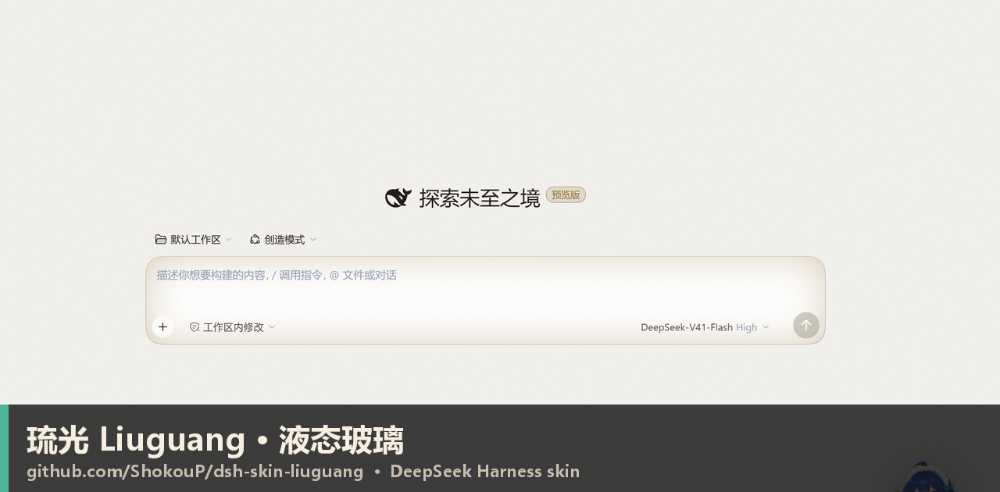
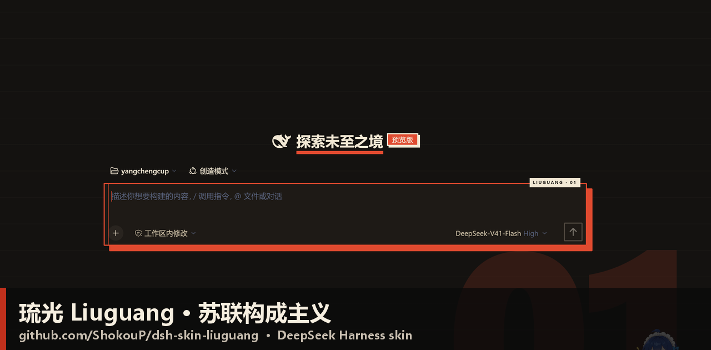

# 琉光 · Liuguang

**给 DeepSeek Harness（DSH）的两套设计语言皮肤：液态玻璃 / 苏联构成主义，随时切换。**

> DSH skin · DSH theme · DeepSeek Harness 皮肤插件 · 可一键撤销 · 可投放皮肤包 · 附带鲸鱼娘桌宠
>
> 关键词（方便搜索）：`deepseek harness skin`、`dsh theme`、`dsh-plugin`、`liquid glass`、`glassmorphism`、
> `soviet constructivism`、`constructivist design`、`桌宠`、`desktop pet`。




> 截图里左侧会话栏做了模糊处理，避免泄露个人会话标题。

---

## 两套设计语言，随时切换

右下角 `✦` → **外观 → 设计语言**，点一下即时切换，不用重启、不用刷新：

| 液态玻璃 / Liquid Glass | 苏联构成主义 / Constructivism |
|---|---|
| 半透明磨砂、内部发光玻璃珠、细噪点、跟随指针的镜面高光 | 米色纸面 + 血红 + 墨黑，硬直角、粗边框、实心偏移投影、海报式标题下划线 |
| 三套底色：**墨银**（暖灰黑+香槟金）/ **深海**（藏蓝+青）/ **暖砂**（褐黑+琥珀） | 明暗两种海报：米色正片 / 墨黑夜版 |
| 强调色可任意自定义 | 红/赭/墨等套色，固定印刷感 |

**两套语言各自拥有独立的选项——不是同一组滑杆换皮：**

- **液态玻璃**：底色（墨银/深海/暖砂）、强调色（预设或取色器）、磨砂 0–60px、通透、圆角、动效。
- **构成主义**：**纸张**（米白/灰白/牛皮/蓝图纸）、**套色**（血红/朱砂/赭石/普鲁士蓝/墨）、**网格**（无/细/粗）、**版心**（宽/中/窄）、**分栏线**（开/关）、**编号**（无/01/02/03 巨号水印）、**编号字体**（黑体/等宽/衬线）、**印章**（输入卡右上角开/关）、**母题**（圆/斜线/无）、**红块**（少/中/多：顶栏厚度、水印浓度、红柱宽度、选中块投影）、**字距**（紧/标准/宽）。



### 预览图（1280×630，可用于分享/OG）




## 功能

- **设计语言切换**：玻璃 ↔ 构成主义，即时生效并记忆。
- **投放式皮肤包**：把 `~/.dsh/liuguang-packs/<id>/`（`pack.json` + `theme.css`）丢进去，面板里立刻出现；坏包只影响自己。见 [docs/skin-packs.md](docs/skin-packs.md)。
- **个性化面板**：外观（玻璃：底色/强调色/磨砂/通透/圆角/动效；构成主义：纸张/套色/网格/编号/印章/母题/字距）、桌宠（显示/大小/话痨/7 种表情试玩/归位）、关于（版本/署名/恢复默认）。
- **鲸鱼娘桌宠**：7 种表情，可拖拽、悬停变开心、点击随机反应并说一句、90 秒无操作犯困。
- **可验证的颜色**：配色在 OKLCH 中定义并由脚本转 sRGB，`npm run check:contrast` 按 WCAG 校验全部文字/UI 配对。见 [docs/digest.md](docs/digest.md)。
- **一键撤销**：删依赖 + 注销 bundle，刷新即回原版；不碰 `app.asar`。

## 安装（Windows 桌面版）

```bat
:: 1. 首次安装：把皮肤注册进当前 DSH profile（会创建 junction + 写入 bundle 注册）
D:\yangchengcup\ui\apply.cmd

:: 2. 重启一次 DSH（首次加载插件必须）
D:\yangchengcup\ui\restart-dsh.cmd
```

撤销：

```bat
D:\yangchengcup\ui\revert.cmd                    :: 移除皮肤
D:\yangchengcup\ui\revert.cmd -RestoreBackup     :: 连 profile 的 patch 一起还原
```

多 profile：`apply.cmd -ProfileName web`；临时 profile 用于测试：`apply.cmd -ProfileName lab`。

## 目录

```
ui/
├─ liuguang/                 主包：宿主注入 + 样式 + 面板/桌宠
│  ├─ lib/index.js           index-inject、/liuguang/theme.css、/liuguang/packs
│  ├─ lib/liuguang.css       全部视觉（玻璃 + 构成主义 + 面板 + 桌宠）
│  ├─ src/overlay.js         React 覆盖层（slot: shell.overlay）
│  └─ tools/palette.mjs      OKLCH → sRGB + WCAG 审计
├─ liuguang-browser/         浏览器面：overlay 挂载、/liuguang/ping、表情图
├─ examples/packs/mist/      示例皮肤包（樱雾）
├─ docs/                     皮肤包格式、生态消化笔记
└─ screenshots/              版本截图（侧栏已模糊）
```

## 设计说明

- 只依赖 `--dsw-*` 设计令牌与语义化钩子（`[data-composer-card]`、`[data-sidebar-right-panel][data-sidebar-right-open]`、`role=treeitem[aria-selected]` 等），**不依赖 CSS-module 哈希类名**，DSH 升级不会静默失效。
- Windows 标题栏模式下侧栏关闭 `backdrop-filter`（否则 fixed 的标题栏按钮会被重新锚定）。
- 输入卡不套 `backdrop-filter`、聚焦不做 `transform`，避免把 `/`、`@` 弹层困进层叠上下文。

## English

**Liuguang** is a skin for the [DeepSeek Harness](https://github.com/deepseek-ai/deepseek-harness) GUI with **two design languages** —
*Liquid Glass* (translucent surfaces, inner-lit glass beads, pointer specular) and *Soviet Constructivism*
(cream/ink/red poster geometry, hard rules, offset shadows) — switchable from the `✦` panel.
It ships a personalization panel, drop-in CSS skin packs, a whale-girl desktop pet with 7 expressions,
and an OKLCH + WCAG-audited palette. Install with `apply.cmd`, undo with `revert.cmd`; nothing is patched inside `app.asar`.

## 许可

- 代码：**MIT**（见 [LICENSE](LICENSE)）。
- 宠物立绘：社区二创，**CC BY-NC-SA 4.0**（署名 上善无形 / ZipZipPipe，见 [assets/pet/CREDITS.md](assets/pet/CREDITS.md)），不属于 MIT 范围，禁止商用。
- 与 DeepSeek 官方无隶属关系。
